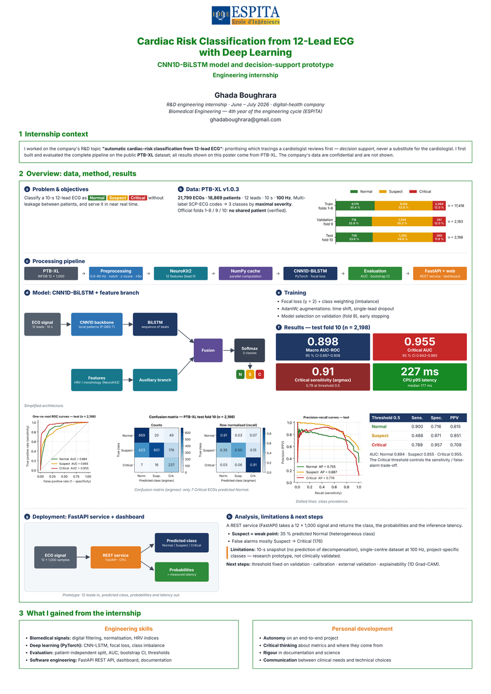

<h1>Ghada Boughrara</h1>

<h3>Biomedical Engineering · AI & Data Science</h3>

  

<h2>🎯 Actively Seeking a Graduation Internship (PFE) — March/April 2027</h2>

---

## About Me

I'm a **fifth-year Biomedical Engineering student at ESPITA, Tunisia**, preparing for a 4–6-month graduation internship (PFE) in 2027.

My academic and practice projects explore **medical image processing, computer vision, biomedical signals, machine learning and healthcare-oriented software**. Most projects in this portfolio are clearly labelled academic/practice work. My 2026 healthcare AI internship was completed in a professional setting and is subject to confidentiality.

I studied **C++ during the first two years of my preparatory cycle** and continue developing my programming and software-engineering skills through coursework and project work.

---

## Experience

### Healthcare AI Internship — Confidential Project
**June–July 2026 · Remote · 2 months**

Contributed to a healthcare AI project involving **ECG signal analysis and deep learning**.

- Biomedical signal processing and classification
- Deep-learning methods, including CNN and LSTM networks
- Healthcare software workflow and model evaluation

Further implementation details and results are not disclosed due to confidentiality.

### Biomedical Engineering Internship — Fattouma Bourguiba Hospital
**June 2025 · Monastir, Tunisia · On-site · Introductory internship**

- Observed biomedical equipment workflows in a hospital environment.
- Gained exposure to preventive maintenance and equipment verification.

### Biomedical Engineering Internship — Clinique La Concorde
**June 2024 · Sousse, Tunisia · On-site · Introductory internship**

- Observed biomedical equipment and engineering workflows.
- Gained exposure to equipment verification and maintenance procedures.

---

## Featured Projects

  

**Professional Internship · June–July 2026**

Contributed to a healthcare AI project focused on ECG signal analysis and deep learning for biomedical signal classification.

**Technical areas:** ECG Signal Processing · Deep Learning · CNN1D-BiLSTM · Model Evaluation · Healthcare Software Development

*The poster presents experiments conducted on the public PTB-XL dataset. Company data, internal results and confidential implementation details are not shown.*

[View full internship poster (PDF)](https://ghada-ecg-internship-poster-full.julius.site?utm_source=shared_artifact)

---

## Academic & Practice Projects

The projects below are academic, independent or practice work. They are presented as engineering and learning projects, not as clinically validated systems.

### [OsteoMorph3D — 3D Bone Morphometry from CT (MATLAB)](https://github.com/ghada-59/Matlab-phantom-Brain-3D-pipeline)

A phantom-first 3D morphometry pipeline built around synthetic ellipsoids with a known analytical volume. It explores HU handling, physical voxel geometry, 3D segmentation, mesh-based measurements and a React/three.js research viewer. Optional DICOM input is supported, but the project is non-clinical. MATLAB-generated measurements and result screenshots are still pending a local execution.

**Highlights:** MATLAB · Image Processing Toolbox · DICOM metadata · Hounsfield Units · Anisotropic voxel spacing · 3D segmentation · Isosurface meshes · Geometric validation · React · Vite · three.js

### [Biomedical Image Denoising Suite](https://github.com/ghada-59/biomedical-image-denoising-suite)

An interactive image-restoration and filtering application for X-ray, MRI and DICOM/CT workflows, comparing spatial and frequency-domain methods and evaluating image-quality measures. Its CT benchmark is exploratory and uses a limited synthetic-noise setup; it is not clinical validation.

**Highlights:** Python · OpenCV · pydicom · NumPy · SciPy · scikit-image · VTK · Streamlit · PSNR · SSIM · pytest · GitHub Actions

### [Brain Tumor MRI Classification — Deep Learning](https://github.com/ghada-59/Brain-Tumor-MRI-Deep-Learning)

A four-class, image-level brain MRI classification project using MobileNetV2 transfer learning. The repository includes dataset checks, duplicate audits, evaluation reports and a demonstration interface. It does not perform tumour segmentation or provide a diagnosis; evaluation is not patient-level clinical validation.

**Highlights:** Python · TensorFlow/Keras · MobileNetV2 · Transfer learning · Image preprocessing · Duplicate audits · Classification metrics · Streamlit

### [SurgiTrack-CPP — 3D Medical Navigation & Safety Simulation](https://github.com/ghada-59/SurgiTrack-CPP)

A C++17 educational simulation for 3D coordinate transformations, rigid registration concepts and trajectory checks against simplified geometric safety zones. It is a mathematical/software-engineering exercise, not a clinical or real-time navigation system.

**Highlights:** C++17 · Eigen · 3D homogeneous transformations · Rigid registration · Geometric safety checks · CMake · GoogleTest · GitHub Actions (Linux/Windows CI)

### [Medical CBIR System — Breast Ultrasound Image Retrieval](https://github.com/ghada-59/Medical_CBIR_System)

A content-based image retrieval project using the BUSI breast ultrasound dataset. It combines intensity, texture and shape descriptors to retrieve similar images and evaluates retrieval consistency with Precision@K. It is not a diagnostic system.

**Highlights:** Python · NumPy · scikit-image · GLCM texture features · Hu moments · Feature normalization · Euclidean and cosine distance · Precision@1 · Precision@5

### [Biomechanical Force Sensor Signal Processing & Calibration — MATLAB](https://github.com/ghada-59/biomechanical-force-sensor-matlab)

A simulation-only instrumentation workflow that generates a synthetic force signal, simulates noisy sensor voltage, applies Butterworth filtering, estimates a linear calibration model and evaluates force-estimation error. No physical sensor is connected.

**Highlights:** MATLAB · Synthetic signal acquisition · Butterworth low-pass filtering · Linear calibration · Peak estimation · R² · RMSE · Signal visualization

### [Brain MRI Classification with Classical Machine Learning](https://github.com/ghada-59/Projet_IRM_Classifier_Naive-_Bayes)

Classical machine-learning experiments for MRI image classification using pixel/HOG representations and handcrafted features with Gaussian Naive Bayes, SVM and Random Forest workflows. The repository keeps separate experiments and evaluation contexts distinct.

**Highlights:** Python · NumPy · scikit-learn · HOG · Handcrafted features · Naive Bayes · SVM · Random Forest

### [MRI Brain Segmentation with Thresholding](https://github.com/ghada-59/Mri-Brain-Segmentation-Mini-Exercice)

A classical image-processing exercise exploring threshold-based MRI segmentation, binary masks and image-intensity analysis.

### [Mammography K-means Segmentation](https://github.com/ghada-59/Mammography-kmeans-segmentation-mini-exercice)

An introductory unsupervised segmentation exercise using K-means intensity clustering. It is a learning project; no diagnostic interpretation is claimed.

### [Diabetes Risk Prediction](https://github.com/ghada-59/Diabetes-Risk-Prediction)

An educational tabular-data workflow for preprocessing and exploring diabetes-risk classification. Dataset provenance and the limited dataset scale should be considered when interpreting the project; it is not a validated clinical risk model.

### [Hierarchical Clustering for Diabetes Dataset Exploration](https://github.com/ghada-59/HAC_diabetes_Segmentation)

An unsupervised-learning project using hierarchical clustering, dendrograms, PCA visualisation and internal cluster-validation measures to explore a diabetes dataset. Clusters are exploratory groups, not clinical patient categories.

## Additional Academic Exercises

- [Biomedical Feature Matrix & Linear Algebra Exercise](https://github.com/ghada-59/Biomedical-Signal-Matrix-Analysis-Exercice) — descriptive statistics, matrix operations and weighted combinations using a small synthetic 4 × 3 feature matrix; not physiological measurements.
- [Diabetes Dataset — Exploratory Data Analysis with ydata-profiling](https://github.com/ghada-59/Diabetes-dataset-ydata-profiling) — notebook-based dataset inspection, missing-value review, descriptive statistics, correlations and automated profiling before modelling.

These repositories demonstrate coursework and practical exploration. Results and limitations should be interpreted within each dataset's provenance, scale and experimental design.

## Technical Skills

### Core Competencies

### Already Studied

### Currently Learning

---

## Certifications & Training

### Certifications

- **IBM SkillsBuild — AI Fundamentals**
- **Cisco Networking Academy — Programming Essentials in Python**

### Current Training

- **GOMYCODE — Data Science Certificate Track** · In progress · Planned completion: **December 2026**
- **GOMYCODE — Full-Stack Web Development Certificate Track** · In progress · Planned completion: **December 2026**

---

## Languages

🇹🇳 **Arabic** — Native  
🇫🇷 **French** — Second language  
🇬🇧 **English** — B2  
🇩🇪 **German** — A2

---

## Leadership & Activities

### General Secretary — Biomedical Club, ESPITA
**October 2023 – May 2024**

- Organized scientific and technical activities.
- Coordinated training sessions, workshops and hospital visits.
- Contributed to the organization of Biomedical Engineering events.

**6th Biomedical Engineering Day**  
*“Transforming Healthcare: The Power of AI in Biomedical Engineering”*

**5th Biomedical Engineering Day**  
*“Biomedical Engineering and the Healthcare Industry: Medicine and Pharma 4.0”*

---

## Soft Skills

---

## Let's Connect

 

**Biomedical Engineering • Continuous Learning**

